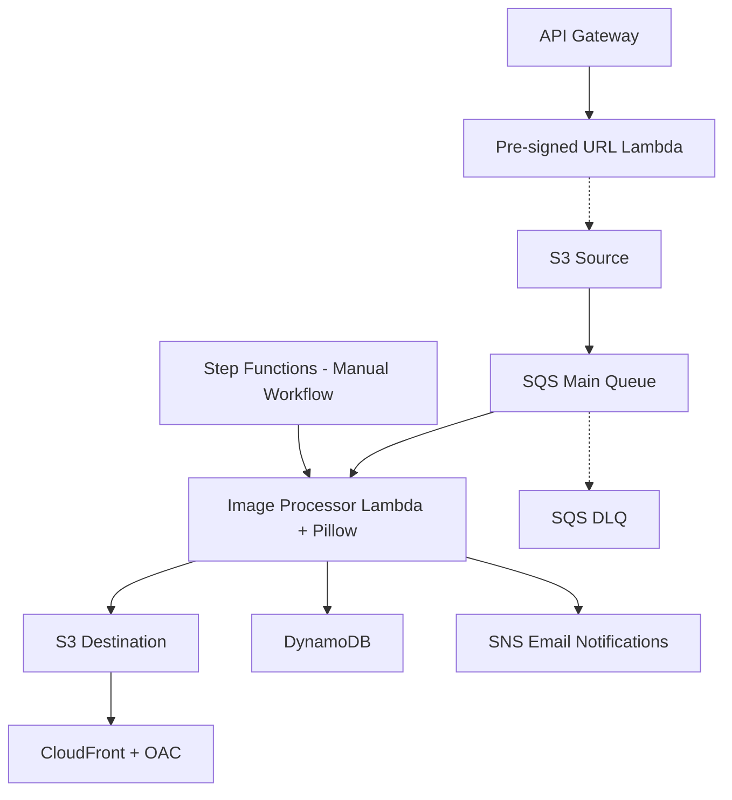

# AWS Serverless Image Processing Pipeline

Graduation Project for the **Manara AWS Solutions Architect – Associate Track**.

An event-driven, serverless image processing solution built with AWS. Users upload JPG images through temporary pre-signed S3 URLs. The pipeline automatically resizes images, applies watermarks, stores processing metadata, sends notifications, and delivers processed images through Amazon CloudFront.

## Architecture

See the [Architecture Diagram](architecture/architecture-diagram.md).



## AWS Services

| Service | Purpose |
|---|---|
| Amazon S3 | Store original and processed images |
| Amazon SQS | Decouple uploads from image processing |
| AWS Lambda | Generate upload URLs and process images |
| Lambda Layer | Provide Pillow image processing dependencies |
| Amazon DynamoDB | Store processing metadata |
| Amazon CloudFront | Deliver processed images through HTTPS |
| AWS Step Functions | Execute a separate image processing workflow |
| Amazon SNS | Send email notifications after processing |
| Amazon API Gateway | Expose the pre-signed URL endpoint |
| Amazon CloudWatch | Logging and monitoring |
| AWS IAM | Least-privilege access control |

## Workflow

1. A user requests a temporary upload URL through API Gateway.
2. The URL generator Lambda returns a pre-signed S3 PUT URL.
3. The user uploads a JPG image to the private source S3 bucket.
4. S3 sends an ObjectCreated event to the SQS main queue.
5. Lambda polls SQS and processes the image using Pillow.
6. The image is resized to fit within 800 × 800 pixels.
7. A watermark is applied.
8. The processed JPEG is saved to the destination S3 bucket.
9. Image metadata is written to DynamoDB.
10. An SNS email notification is published.
11. CloudFront delivers the processed image using HTTPS.
12. Failed SQS messages are retried and eventually moved to the DLQ.

## Image Processing

The image processor performs:

- EXIF orientation correction.
- RGB conversion.
- Aspect-ratio-preserving resizing.
- Text watermarking.
- JPEG compression.
- Metadata extraction and storage.

## Reliability

- SQS Standard Queue provides asynchronous buffering.
- Visibility timeout: 180 seconds.
- Lambda timeout: 30 seconds.
- DLQ redrive threshold: 3 receives.
- Invalid image files generate processing errors.
- Failed messages are isolated in the DLQ.

### Known Limitation

SQS Standard supports at-least-once delivery, so duplicate processing and duplicate SNS notifications are possible.

The current image ID is derived from the S3 object key. Re-uploading a different image with the same key can overwrite existing metadata.

## Security

- S3 buckets are private.
- S3 Block Public Access is enabled.
- CloudFront accesses S3 through Origin Access Control.
- Lambda uses IAM execution roles instead of hardcoded credentials.
- IAM policies restrict access to specific resources.
- Pre-signed upload URLs expire after 300 seconds.

**Important:** The API Gateway upload endpoint is publicly accessible in the demo configuration. Production deployments should add authentication, throttling, file validation, and upload size restrictions.

## Cost Optimization

- Serverless architecture without EC2 or NAT Gateway.
- DynamoDB On-Demand capacity.
- Small test images.
- S3 SSE-S3 encryption.
- CloudWatch Logs retention can be limited to 7 days.
- AWS Budgets configured for cost monitoring.

AWS Free Tier and credits may cover some usage, but costs are not guaranteed to be zero.

## Testing

Successfully tested:

- S3 event notifications.
- SQS-to-Lambda automatic processing.
- Resize and watermark generation.
- DynamoDB metadata persistence.
- SQS retries and DLQ routing.
- CloudFront private S3 delivery.
- Step Functions execution.
- API Gateway pre-signed upload URLs.
- SNS email notifications.

## Repository Structure

```text
architecture/       Solution architecture diagram
lambda/             Lambda function source code
step-functions/     State machine definition
iam/policies/       IAM policy examples
docs/               Deployment and testing documentation
screenshots/        Sanitized testing evidence
```

## Future Improvements

- Stronger idempotency using DynamoDB conditional writes.
- Multi-step Step Functions orchestration.
- Authentication for the upload API.
- File size and MIME-type validation.
- Improved SNS notification deduplication.
- Infrastructure as Code using Terraform or AWS SAM.
- Automated testing and CI/CD.

## Project Status

**Implemented and tested on AWS.**

The main event-driven pipeline is fully functional. Step Functions is currently implemented as a separate single-task manual workflow rather than part of the automatic SQS processing path.

## Disclaimer

This repository is an educational graduation project, not a production-ready deployment.
