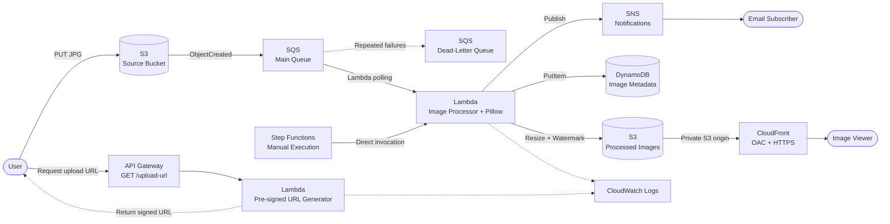

# Solution Architecture

## Architecture Notes

- The primary image processing pipeline is event-driven through S3, SQS, and Lambda.
- Step Functions provides a separate manually triggered workflow that invokes the existing image processor.
- CloudFront uses Origin Access Control (OAC) to access the private destination S3 bucket.
- SQS Standard provides at-least-once delivery. Duplicate processing is possible.
